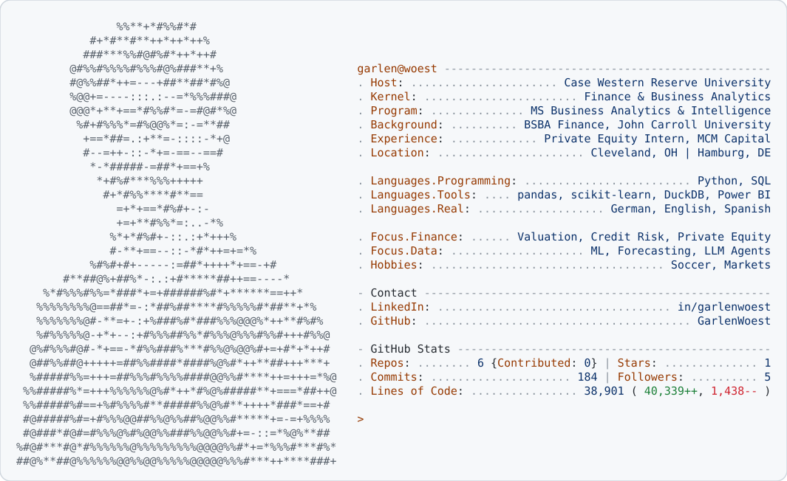

<a href="https://github.com/GarlenWoest">
  <picture>
    <source media="(prefers-color-scheme: dark)" srcset="card-dark.svg">
    
  </picture>
</a>

  <a href="https://www.linkedin.com/in/garlenwoest/">
    <picture>
      <source media="(prefers-color-scheme: dark)" srcset="assets/btn-linkedin-dark.svg">
      
    </picture></a>&nbsp;&nbsp;<a href="https://github.com/GarlenWoest?tab=repositories">
    <picture>
      <source media="(prefers-color-scheme: dark)" srcset="assets/btn-projects-dark.svg">
      
    </picture></a>

